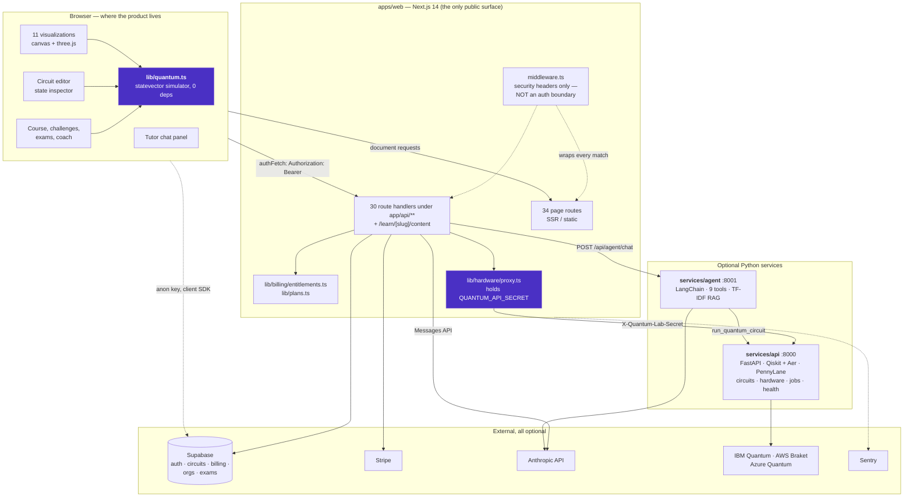
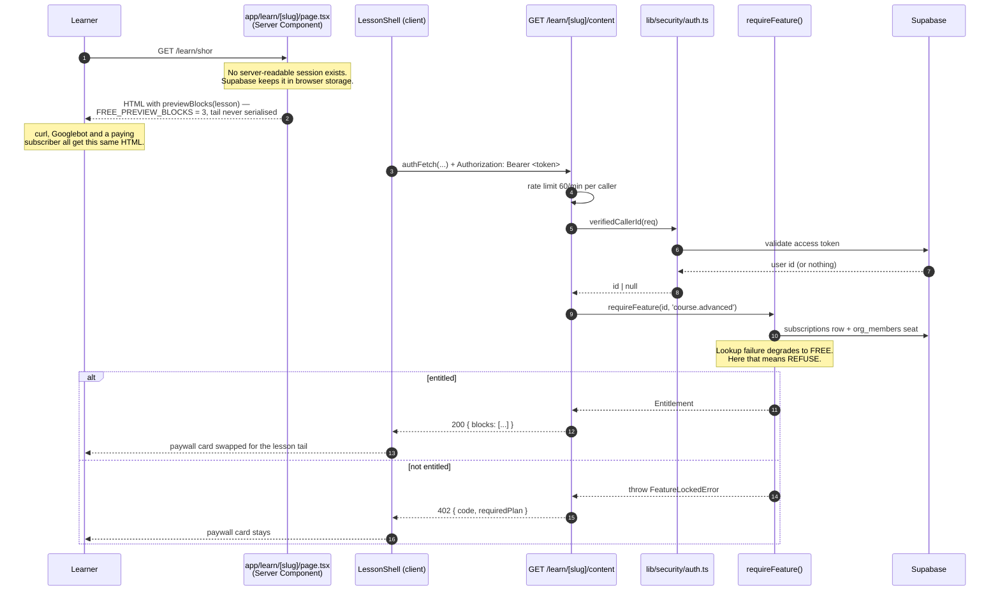
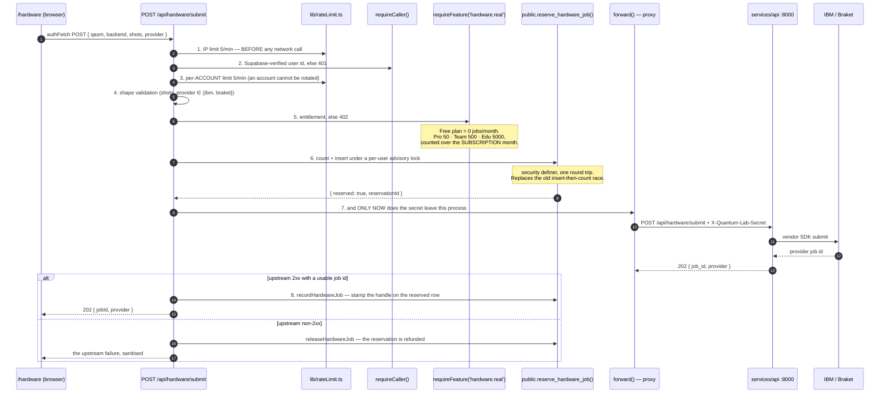
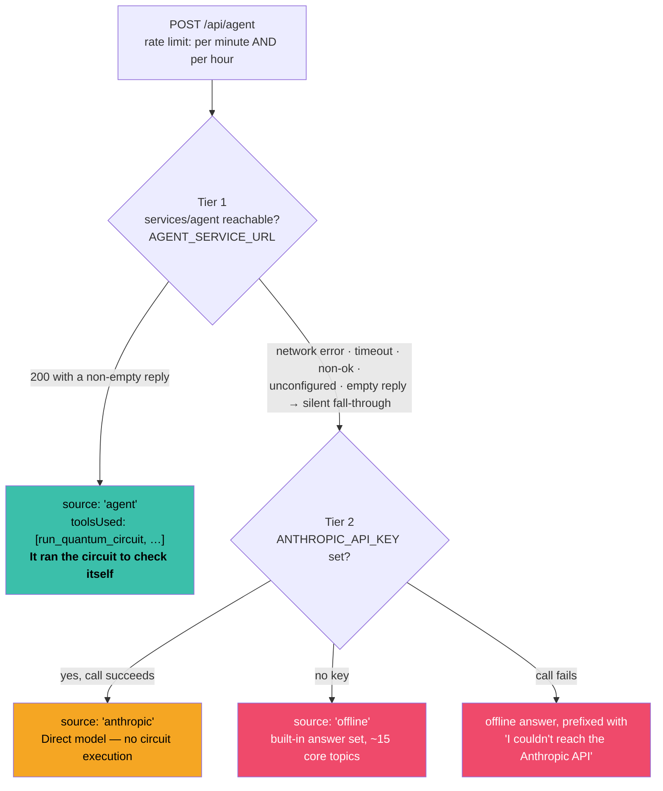
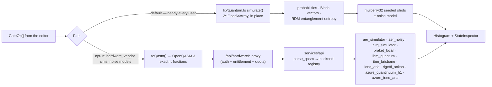

# Architecture

Quantum Lab is deliberately lopsided: almost everything a learner touches happens in the browser,
and the servers exist for the small set of things a browser genuinely cannot do — spend money on
real quantum hardware, hold an API key, verify who is asking, and grade an exam nobody can edit.

Every diagram below was checked against the code it describes. Where the code and a diagram
disagree, the code is right and the diagram is a bug — fix it here.

---

## 1. The three services, and what actually talks to what

Three properties of that picture are load-bearing:

- **The browser never calls `services/api` directly.** `NEXT_PUBLIC_API_URL` is read *server-side*
  by `lib/hardware/proxy.ts`; the name kept its `NEXT_PUBLIC_` prefix so existing deployments did
  not break, and `docs/SECURITY.md` explains why the value is not a secret. The shared secret
  never enters a browser bundle.
- **`middleware.ts` is not an auth boundary and says so in its own header.** It sets security
  headers and nothing else — no awaits, no fetches, no cookie parsing. Authorisation is per route
  handler.
- **Everything in `EXT` is optional.** With an empty environment the app boots, every page
  renders, progress goes to `localStorage`, and the tutor answers from its offline set.

### Why a client-side simulator at all

`lib/quantum.ts` duplicates work Qiskit already does well, on purpose:

- **Instant feedback.** Dragging an RY angle recomputes the statevector every frame. A network
  hop makes that impossible, and immediacy is what turns "I read about superposition" into "I
  understand superposition".
- **Zero marginal cost.** A class of 300 costs exactly what one student costs.
- **Works offline.** Classroom wifi is a real constraint; the PWA fallback depends on this.
- **No infrastructure dependency.** The teaching product — the thing people come for — has no
  database, no queue and no server to page anyone about.

---

## 2. The entitlement path: from a click to a server refusal

The rule this repository learned the hard way: **a check that runs only in a client component is
decoration.** Two of the three entitlement helpers once had zero callers while every visible gate
was cosmetic, and the paid advanced track was served in full to `curl`. This is the shape now.

The same shape guards every paid capability. The client-side half is presentation only: it can
reveal nothing the route handler did not already agree to send.

| Capability | Server gate | File |
| --- | --- | --- |
| Advanced lesson body | `verifiedCallerId` + `requireFeature('course.advanced')` | `app/learn/[slug]/content/route.ts` |
| Advanced exam paper | `resolveSubject` + `requireFeature('certification')` | `lib/exams/service.ts` |
| Real hardware submission | full chain in § 3 | `app/api/hardware/submit/route.ts` |
| Org / classroom actions | `requireOrgRole()` against the org named in the request | `lib/orgs/access.ts` |
| Plan resolution | Stripe webhook → `subscriptions`; there is **no user write policy** on that table | `app/api/billing/webhook/route.ts` |

`/api/billing/entitlement` answers 200-with-free on a lookup failure rather than an error, because
a paying user seeing an error box on every page load is worse than a briefly wrong plan badge —
and nothing is unlocked by it, since every route that grants a paid capability re-checks.

See [ADR-0005](adr/0005-entitlements-are-enforced-server-side-only.md).

---

## 3. The hardware submission chain, end to end

This is the one path that spends the operator's money. Each accepted call enqueues a job on IBM or
Braket against the **operator's** credentials.

Polling is `GET /api/hardware/job/[provider]/[...jobId]`, and it deliberately carries **no**
`requireFeature` and no quota check — the job was already paid for. What it does carry is
ownership: `recordHardwareJob` binds the provider handle to the submitter's row, so polling cannot
read a stranger's results.

If `SUPABASE_SERVICE_ROLE_KEY` is unset the quota store is unreachable and **every submission is
refused**. That is the intended fail-closed behaviour, not a bug.

Known and open: a job that returns 2xx with no usable `job_id` keeps its usage row and is
unpollable. It is logged (`markHardwareJobUnmatched`), not handled.

---

## 4. The tutor's three-tier degradation

`/tutor` promises one thing: **you always get a reply.** The status line names the tier that
actually answered, so the promise is not kept by pretending.

- **Tier 1 failure is silent to the learner.** Every failure mode returns `null` from
  `tryAgentService` and falls through; the learner never sees an error for it.
- **A 429 still carries a `reply`.** Without it the tutor renders a blank bubble.
- `GET /api/agent` reports which tier *would* serve a request right now, which is what the status
  line reads. On a rate-limited probe it answers `offline` rather than 429 — the UI treats a
  non-200 as "no information", and "offline" is the honest floor.
- Inside tier 1, `services/agent` degrades again: an unreachable `services/api` makes
  `run_quantum_circuit` fall back to a local Aer run in-process, and a missing RAG index makes
  `search_concepts` fall back to the 18-concept keyword base. Both are reported as `degraded` by
  `GET /api/agent/health`, never as `ok`.

---

## 5. Circuit execution: two paths, one histogram

The client path makes no network call at any point. The two paths render through the *same*
`Histogram` component, which only works because the bitstring convention in `quantum.ts` was
chosen to match Qiskit exactly — see
[ADR-0003](adr/0003-qubit-0-is-the-lsb-with-msb-first-labels.md).

Vendor SDKs in `services/api` are imported lazily inside `try/except ImportError`, so a missing
package degrades to `available: false` rather than crashing at startup. `app/quantum/pennylane_runner.py`
is the single middleware layer: it translates the already-parsed QASM into PennyLane gate calls and
normalises the result into the exact dict `run_circuit` has always returned. Translation of an
unsupported gate raises during translation, before execution, so the caller can fall back to the
Qiskit path rather than silently returning a wrong distribution.

`services/api` also has an async job surface (`POST /api/jobs` → `202 { job_id }`, plus
poll, list, stats and cancel) backed by `app/jobs/store.py`. Without `REDIS_URL` that store is a
bounded in-process dict: jobs are lost on restart and invisible to other replicas, which is why
Redis sits in the `queue` Compose profile and is off by default. See `services/api/docs/JOBS.md`.

---

## 6. The data model

Nothing below is required to run the app. With no Supabase project, saved circuits, progress,
challenge results and exam attempts live in `localStorage` and every feature that reads them
works. **These policies have never been executed against a live project** — see § 5.1 of
`docs/DEPLOYMENT.md`.

```mermaid
erDiagram
    AUTH_USERS ||--o{ CIRCUITS : owns
    AUTH_USERS ||--o| SUBSCRIPTIONS : has
    AUTH_USERS ||--o{ HARDWARE_USAGE : "reserved by"
    AUTH_USERS ||--o{ ORG_MEMBERS : "seats"
    AUTH_USERS ||--o{ EXAM_CERTIFICATES : "holds"
    ORGS ||--o{ ORG_MEMBERS : has
    ORGS ||--o{ ORG_INVITES : issues
    ORGS ||--o{ ORG_ASSIGNMENTS : publishes
    ORGS ||--o{ ORG_PROGRESS : receives
    ORGS ||--o{ ORG_PROGRESS_CONSENT : "gated by"
    EXAM_ATTEMPTS ||--o| EXAM_CERTIFICATES : "one per pass"

    AUTH_USERS {
        uuid id PK "Supabase-managed"
    }
    CIRCUITS {
        uuid id PK
        uuid user_id FK
        text name
        text qasm "OpenQASM 3 is the storage format"
        int num_qubits
        bool is_public "public read policy"
    }
    SUBSCRIPTIONS {
        uuid user_id PK
        text stripe_customer_id
        text plan_id "free|pro|team|edu"
        text status
        timestamptz current_period_end
        bool cancel_at_period_end
    }
    HARDWARE_USAGE {
        uuid id PK
        uuid user_id FK
        text backend
        int shots
        timestamptz created_at "the quota window"
    }
    STRIPE_EVENTS {
        text id PK "idempotency ledger for the webhook"
    }
    ORGS {
        uuid id PK
        text name
        text plan_id
    }
    ORG_MEMBERS {
        uuid org_id FK
        uuid user_id FK
        text role "owner|admin|member"
        text status "active|invited|suspended"
    }
    ORG_INVITES {
        text token_hash "SHA-256 of a 32-byte random token"
        timestamptz expires_at
        timestamptz accepted_at "single use"
    }
    ORG_ASSIGNMENTS {
        uuid id PK
        text title
        timestamptz due_at
        jsonb items
    }
    ORG_PROGRESS_CONSENT {
        uuid org_id FK
        uuid user_id FK "self-granted only — no userId parameter exists"
    }
    ORG_PROGRESS {
        uuid org_id FK
        uuid user_id FK
        jsonb snapshot "replaced wholesale; NOT an event log"
        jsonb completions
    }
    EXAM_ATTEMPTS {
        text id PK
        text exam_id
        text subject_kind "user|guest"
        text subject_id
        timestamptz expires_at "server clock, never recomputed"
        text_array question_ids "the paper, written down"
        jsonb answers
        float score "server-written; NULL until submitted"
        bool passed
    }
    EXAM_CERTIFICATES {
        text id PK "QL-XXXXX-XXXXX-C, 50 bits + checksum"
        uuid user_id FK
        text attempt_id FK "unique — one certificate per pass"
        text display_name "self-attested, and /verify says so"
        float score "kept for disputes, NOT returned by /verify"
    }
```

Three decisions in that schema are worth naming:

- **`subscriptions` has no user write policy at all.** Its absence is the entire billing security
  model: a browser holding the anon key cannot set its own `plan_id`.
- **`exam_attempts` stores the paper, not a seed.** The old design reconstructed questions from a
  seed, which meant adding a question to the bank silently re-dealt every attempt in flight —
  including ones a certificate had been issued for.
- **`org_progress` is a snapshot, not an activity stream.** No history, no per-action timestamps.
  A learner grants sharing themselves, per organisation; there is no `userId` parameter on
  `/api/orgs/progress/consent`, by design. See `docs/CLASSROOM.md`.

Which schema file holds what, and the order they must be run in (later files reuse the
`set_updated_at()` helper the first one defines):

| # | File | Tables |
| --- | --- | --- |
| 1 | `supabase/schema.sql` | `circuits` |
| 2 | `supabase/schema-billing.sql` | `subscriptions`, `hardware_usage`, `stripe_events`, `reserve_hardware_job()`, `apply_stripe_subscription()` |
| 3 | `supabase/schema-exams.sql` | `exam_attempts`, `exam_certificates` |
| 4 | `supabase/schema-orgs.sql` | `orgs`, `org_members`, `org_invites`, `org_assignments`, `org_progress_consent`, `org_progress` — **read § 5.2 of `docs/DEPLOYMENT.md` first; re-running it deletes unclaimed invites** |

The analytics sink has no schema file on purpose: `/api/analytics` inserts into whatever table
`ANALYTICS_SUPABASE_TABLE` names, ingestion is off unless an operator sets it, and the correct
policy set on that table is *none at all* with RLS enabled. See `supabase/README.md`.

---

## 7. Where a newcomer's mental model usually goes wrong

- **`lib/lessons/index.ts` is metadata; `lib/lessons/server.ts` is the only way to a body.** The
  bodies hold ~152 kB of text, ~69 kB of it the paid track, and `index.ts` is reachable from the
  global client graph via `layout → SiteNav → CommandPalette → lib/search/corpus`. Importing a
  body module from a client component would ship the paid course to everyone;
  `lib/lessons/bundle.test.ts` walks the import graph from every `'use client'` module and fails
  if it can reach one.
- **`docs/` is per-service, not central.** `services/api/docs/` holds HARDWARE, JOBS and PENNYLANE;
  `services/agent/docs/` holds RAG. The `docs/HARDWARE.md` at the root is the product-side view of
  the same chain.
- **There are two rate limiters.** `lib/rateLimit.ts` counts in a shared Redis when
  `UPSTASH_REDIS_REST_*` or `KV_REST_API_*` are set, and guards the routes that spend money.
  `lib/security/ratelimit.ts` is the older in-process one and is still used where a per-instance
  speed bump is all that is claimed. Neither is a control against a distributed attacker, and both
  headers say so.
- **`app/global-error.tsx` renders its own `<html>`/`<body>`.** It replaces the root layout when
  *that* fails, so it cannot rely on `globals.css`. Leave that shape alone.
- **No error boundary renders a `<main>`.** `app/layout.tsx` owns the single `main` landmark; a
  second one was the `main > main` defect closed across 19 routes.

---

## 8. What is not built, and the trigger for building it

- **A distributed job queue for hardware.** `services/api` already returns a job handle
  immediately and polls, so the async shape exists. What does not exist is a broker and a worker
  owning a long-lived vendor session. Redis is declared in `docker-compose.yml` under the `queue`
  profile for exactly this. The trigger is more than one replica, or a poll interval long enough
  that losing the in-process store on restart matters.
- **Per-class cohorts.** Today one licence is one cohort. The honest route is a `cohorts` table
  with its own membership and its own `requireCohortRole`, not a `cohort_id` column bolted onto a
  scoping rule nothing has ever filtered on.
- **Server-side lesson progress.** Progress is `localStorage` and `/insights` computes every
  number in the browser. Course progress reaches an org only through the explicit, revocable,
  per-org grant in `docs/CLASSROOM.md`.
- **`import 'server-only'`** on `lib/lessons/server.ts`. That package is not a dependency, and it
  would turn a client import into a build error rather than the runtime throw that guards it now.
  Worth adding the day someone owns `package.json`.
