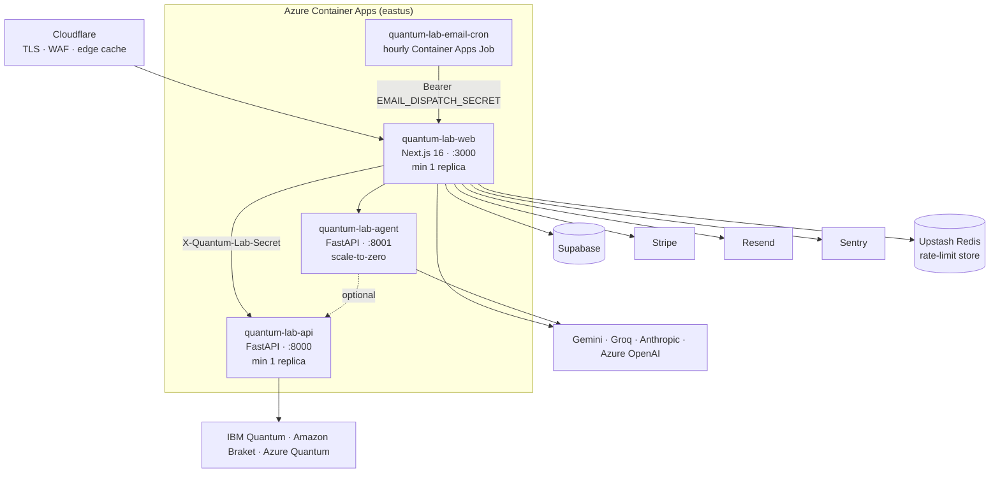

# Architecture overview

Qubit16 is three services behind a CDN, plus two thin store apps that display the web product. The guiding constraint is that **the browser does all the physics** and the server does only what a browser cannot: identity, metering, money, real hardware and large models.

## Components

### apps/web

The product. Pages are statically prerendered wherever possible (lessons, challenges, paths, glossary and exams use `generateStaticParams`), because identity travels in a request header rather than a cookie, so no page needs a server-side session to render. The 61 route handlers are where authorisation, rate limiting, quota reservation and proxying happen. Details: [Web application](web.md).

### services/api

Executes OpenQASM 3 on Qiskit Aer or PennyLane Lightning, estimates costs, transpiles for a target device, and submits to real hardware on IBM Quantum, Amazon Braket (IonQ, Rigetti) and Azure Quantum (Quantinuum, IonQ). The browser never calls it directly: every request goes through a web route handler that has already authenticated the caller, checked the plan and reserved quota. Details: [Real quantum hardware](../platform/hardware.md).

### services/agent

The QuantumMind tutor: a LangChain tool-calling agent with thirteen tools (run a circuit, inspect the statevector step by step, diff two circuits, search the course, fetch an arXiv paper, …) and TF-IDF retrieval over the course text. It holds no state and no database; the learner's progress snapshot arrives with each request. Details: [AI tutor & agent](../platform/tutor.md).

### Managed services

Every one is optional. With no Supabase there are no accounts and everything persists in `localStorage`; with no Stripe the pricing page says checkout is not configured; with no LLM key the tutor runs its offline tier; with no Redis the rate limiter uses an in-process store and says so at startup. This is tested, not aspirational: `scripts/preflight.mjs` and the three `env_check` validators treat an empty environment as valid, and CI's API job asserts that `python -m app.core.env_check` passes with nothing set.

## Data flow for the common cases

**Simulating a circuit.** No network request. `simulateSteps()` in `lib/quantum.ts` runs on every edit (about 50 ms for 16 qubits and 20 gates), and one pass feeds the amplitude table, phase disks, Q-sphere, column probe and research tools.

**Reading a paid lesson.** The HTML served to everyone, crawlers included, contains the first three blocks. After mount, the page fetches `GET /learn/[slug]/content` with the session token; the handler verifies the token, checks the `course.advanced` feature and returns the withheld blocks, or 402. The paid prose is never in the client bundle (ADR-0006) and never in the public HTML.

**Running on real hardware.** Browser → `POST /api/hardware/submit` → IP rate limit → token verification → per-account rate limit → shape validation → BYOK credential resolution → `hardware.real` feature check → atomic quota reservation under a per-user advisory lock → forward to `services/api` with the shared secret → provider submission → job handle recorded, or the reservation released on failure. See [Trust boundaries](trust-boundaries.md).

**Asking the tutor.** Browser → `POST /api/agent` → clamps (12/min, 100/hour, 8,000 characters per message, 24,000 total) → tier resolution from the entitlement → provider resolution (cheapest ready provider unless pinned) → the Python agent with tools if it is healthy, else a direct model call, else the offline FAQ. ADR-0009: the tutor degrades in three *visible* tiers.

## Why three services and not one

The web app could, in principle, call Qiskit through a serverless function. It does not, for three reasons that are recorded in the code:

1. **Dependency weight.** Qiskit, Aer and the three vendor SDKs are roughly 120 MB of Python. Keeping them out of the web image keeps web cold starts fast and lets the simulator-only deployment skip them with one build argument.
2. **Blast radius.** The hardware service holds vendor credentials and can spend money. It is reachable only through the web app's gate chain and a shared secret, never from a browser.
3. **Independent scaling.** The agent scales to zero when nobody is chatting; the API stays warm because a cold start of Qiskit is measured in seconds.

## Document map

| Topic | Page |
| --- | --- |
| Request lifecycle, authentication and the trust model | [Trust boundaries](trust-boundaries.md) |
| Rendering, design system, PWA, SEO, integrations | [Web application](web.md) |
| Supabase schema, RLS, where data lives | [Data & accounts](data.md) |
| Plans, entitlements, Stripe, quotas | [Billing & entitlements](billing.md) |
| The physics engine | [Simulator](../simulator/index.md) |
