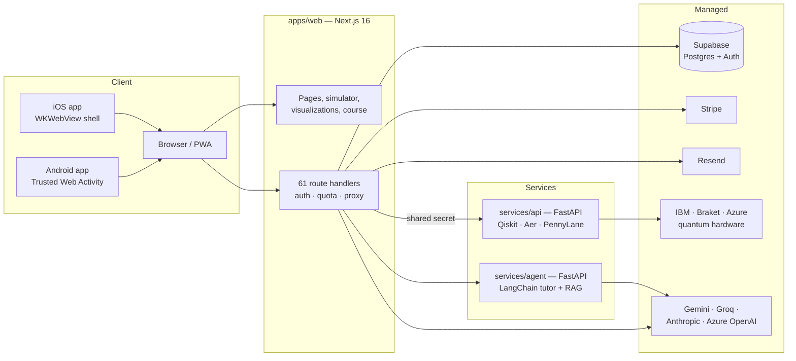

# How Qubit16 is built

**qubit16.ai** is an open-source platform for learning quantum computing by playing with it: a 16-qubit statevector simulator that runs in the browser, forty interactive visualizations, a fifteen-lesson course, an AI tutor, and a path to real quantum hardware. It is developed by **Cloudspace Learning and Development Private Limited** and released under the MIT licence.

This site is the engineering documentation: the architecture, the physics engine and how it is verified, the security model, the test and deployment pipeline, and the practices the codebase is held to. It is written for engineers who want to understand, run, extend or audit the system.

[Source on GitHub](https://github.com/CloudspaceLearningAndDevelopmentPVTLTD/quantum-lab){ .md-button .md-button--primary }
[Open qubit16.ai](https://qubit16.ai){ .md-button }

<strong>16</strong>qubits, exact, in the browser, free for everyone

<strong>10⁻⁹</strong>agreement with Qiskit required on every amplitude

<strong>100</strong>pages and 61 API route handlers in the web app

<strong>4,100+</strong>automated tests across three services

<strong>29</strong>database tables, every one with row-level security

<strong>0</strong>required environment variables to run the whole stack

## What the system is

Three services and two store apps, with the browser doing most of the work:

The simulator, every visualization, the circuit editor, the course and the offline tutor execute entirely in the browser. The server exists for accounts, metered quotas, real hardware and large language models, and every one of those is optional: the stack builds and runs with an empty environment and degrades visibly rather than failing.

## Where to start

  <a class="q16-card" href="architecture/"><h3>Architecture</h3>
The three services, request lifecycle, trust boundaries, data model and billing.
</a>
  <a class="q16-card" href="simulator/"><h3>Simulator engine</h3>
A zero-dependency statevector engine: gate set, OpenQASM 3, classical control, GPU backend.
</a>
  <a class="q16-card" href="simulator/verification/"><h3>Verification</h3>
How the engine is checked against Qiskit and PennyLane on random circuits up to 16 qubits.
</a>
  <a class="q16-card" href="security/"><h3>Security</h3>
Threat model, per-route authorisation, headers, rate limiting, secrets and store-app compliance.
</a>
  <a class="q16-card" href="quality/"><h3>Quality &amp; testing</h3>
Unit, end-to-end, accessibility and cross-check suites, and the CI gates that run them.
</a>
  <a class="q16-card" href="operations/"><h3>Operations</h3>
Containers, Azure Container Apps, continuous deployment, health, observability and email.
</a>

## The stack at a glance

| Layer | Technology |
| --- | --- |
| Web application | Next.js 16 (App Router, Turbopack), React 19, TypeScript 5.6 strict, Tailwind CSS 3.4, Radix primitives, three.js |
| Physics engine | Hand-written TypeScript statevector simulator (zero runtime dependencies), optional WebGPU backend, stabilizer tableau |
| Accounts and data | Supabase (Postgres, Auth, row-level security), 29 tables, 15 idempotent migrations |
| Billing | Stripe Checkout, webhooks and customer portal; entitlements enforced server-side only |
| Hardware service | FastAPI, Qiskit + Aer, PennyLane Lightning; IBM Quantum, Amazon Braket, Azure Quantum SDKs |
| Tutor service | FastAPI, LangChain tool-calling agent, TF-IDF retrieval over the course, LiteLLM provider routing |
| Delivery | Docker (non-root, multi-stage), Azure Container Apps, Cloudflare, GitHub Actions with OIDC |
| Quality | Vitest, Playwright + axe-core, pytest, Qiskit/PennyLane cross-checks, bundle budgets, WCAG 2.2 AA audit |
