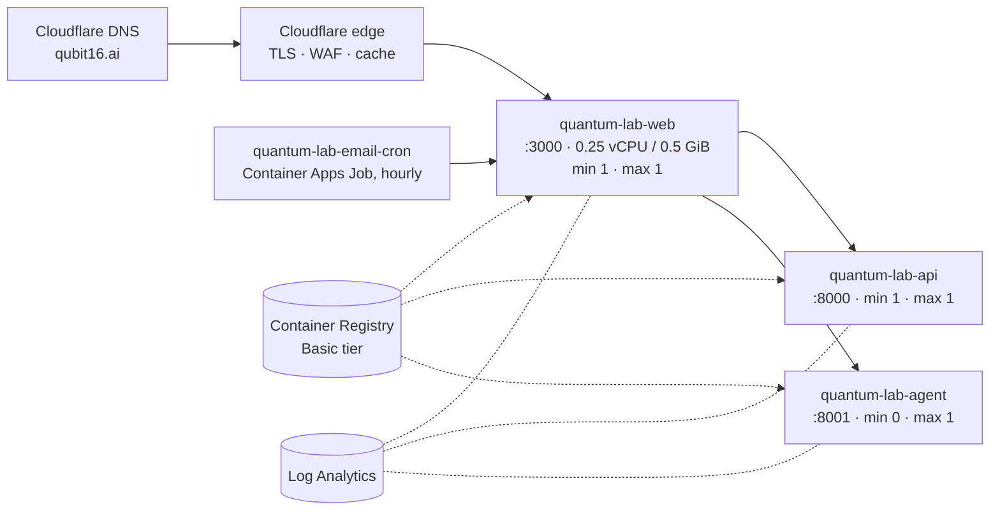

# Deployment

Production runs on Azure Container Apps behind Cloudflare. The same images deploy to AWS App Runner, Google Cloud Run, Railway, Vercel or a single Docker Compose host; those paths are documented and the configuration files for each are in the repository.

## Containers

All three images are multi-stage, run as non-root users and declare health checks.

**Web** (`apps/web/Dockerfile`, `node:20-alpine`): a `deps` stage runs `npm ci` from the root lockfile (the build context must be the repository root because of the workspace), a `builder` stage sets `NEXT_PRIVATE_STANDALONE` and builds with the public `NEXT_PUBLIC_*` arguments baked in, and a `runner` stage copies only `.next/standalone`, `.next/static` and `public`, running `node apps/web/server.js` as user `nextjs`.

**API and agent** (`python:3.11-slim`): a builder stage creates a virtual environment with the runtime requirements (pytest stripped), the runtime stage copies the application code (and, for the agent, the committed retrieval index, without which retrieval would silently fail open), runs as user `quantum`, and starts with `python -m …env_check && exec uvicorn …` so a misconfigured container exits before it serves. The API image installs the hardware SDKs by default; `INCLUDE_HARDWARE_SDKS=0` produces a simulator-only image about 120 MB smaller.

A new `NEXT_PUBLIC_*` variable must be added in three places (the environment template, the deploy script's build arguments, the Dockerfile's `ARG`/`ENV` pair), and the deploy script's comments say so.

## Azure topology



The API stays at one warm replica because a Qiskit cold start is measured in seconds; the agent scales to zero because conversations are bursty and its cold start is acceptable. A `$50/month` budget alert is created best-effort. Resource sizes are the smallest Consumption-plan allocation, which is sufficient because the browser does the simulation.

## `infra/azure/deploy.sh`

The first deploy, secret rotation and new variables go through this script, which is idempotent (every step is check-then-act):

1. Re-executes itself from a clean `git worktree` of `HEAD`, so uncommitted edits are never deployed.
2. Loads the gitignored `.env.production` and refuses to build the web image if the Supabase variables are empty.
3. Creates or reuses the resource group, Log Analytics workspace, Container Apps environment and registry.
4. Builds the three images in Azure (`az acr build`, no local Docker), polling the build queue.
5. Creates or updates the three apps with Container Apps secrets referenced as `secretref:`; the web/API shared secret is rotated only when `ROTATE_API_SECRET=1`, using the API's comma-separated overlap so the rotation causes no outage.
6. Builds the web image a second time with the real API and agent hostnames baked in.
7. Curls the three health endpoints.

`attach-domain.sh` binds the custom domain: it prints the TXT and apex records to add, polls until Azure can verify them, binds a managed TLS certificate, rebuilds the web image with the public URL and adds the origin to both services' CORS allow-lists. `deploy-email-cron.sh` creates the hourly job that drives the onboarding email course. `setup-github-oidc.sh` creates the federated identity for the CD workflow, scoped to one repository, one environment and one resource group, with Contributor on the resource group only.

## Continuous deployment

Described in [CI pipeline](../quality/ci.md): after a green CI run on `main`, the workflow rebuilds only the services whose paths changed, tags images with the commit SHA, updates the apps and smoke-tests the public health endpoint. Rolling back is pointing the app at the previous image tag:

```bash
az containerapp update -n quantum-lab-web -g quantum-lab-rg --image <registry>/quantum-lab/web:<previous-tag>
```

Container Apps keeps the previous revision, so traffic can also be shifted back without a rebuild.

## Cloudflare

Cloudflare fronts the public hostname: TLS termination with HSTS, a WAF, edge caching of static assets, and the `cf-connecting-ip` header the rate limiters use. The operational checklist records the hardening that belongs in the dashboard rather than the code: Full (strict) TLS to the origin, WAF rules for scanner paths (`/.env`, `/.git`, `wp-*`), blocking non-standard ports, an edge rate limit on `/api/*` as a second layer, and restricting the Container Apps hostnames to Cloudflare's address ranges so the origin cannot be reached directly.

## Local development

```bash
npm install && npm run dev          # web on :3000, empty environment is fine
cd services/api && uvicorn app.main:app --reload --port 8000     # optional
cd services/agent && uvicorn agent.server:app --reload --port 8001  # optional
```

`docker-compose.yml` runs all three with the services bound to loopback and an optional Redis profile. `scripts/setup.sh` (and `.ps1`) and `docs/RUNBOOK.md` cover a from-nothing setup on macOS, Linux and Windows.
