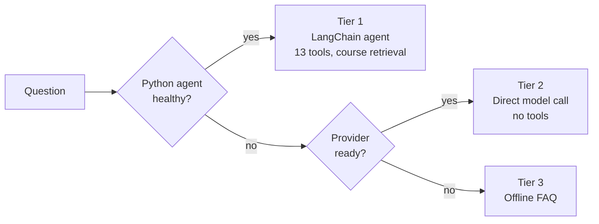

# AI tutor & agent

The tutor, QuantumMind, answers questions about quantum mechanics at the learner's level and can reason about the circuit on the learner's screen, gate by gate. It is built so that it never fails silently and never costs more than the operator decided it should.

## Three visible tiers (ADR-0009)

The web route `POST /api/agent` probes the agent's health (1.5 s budget), uses it if it is up (25 s budget), otherwise calls a provider directly through the Vercel AI SDK with no tools, and otherwise serves the offline FAQ. The interface tells the learner which tier answered. The on-device tier (below) is a fourth option the learner chooses explicitly.

## Provider resolution

Four providers are supported through one abstraction: Gemini, Groq, Anthropic and Azure OpenAI. The agent speaks to them through LiteLLM (`gemini/…`, `groq/…`, `anthropic/…`, `azure/<deployment>`); the web app's direct tier uses the matching AI SDK packages. `lib/llm/resolve.ts` picks a provider in a fixed order of precedence:

1. The learner's **tier policy** (anonymous, free, trial, paid) decides whether any model is called at all and how many messages per day are allowed.
2. A platform-wide **forced provider**, if one is set and ready.
3. A **per-tier pin**.
4. The configured **order**, cheapest-first by default (Gemini's free tier, then Groq, then Anthropic, then Azure), first ready provider wins.

A pinned provider that is not ready falls through to the next rule, so a configuration mistake degrades to a different provider rather than taking the tutor offline. The decision is made once in the web app and forwarded to the agent as an override, so both runtimes follow it. Policy lives in environment variables as the base layer with a `platform_settings` row on top, editable at `/admin/platform` by addresses listed in `PLATFORM_ADMIN_EMAILS`; the allow-list is an environment variable rather than a table so a compromised admin session cannot lock everyone out.

## The agent service

`services/agent` is a FastAPI service around a LangChain tool-calling agent (`AgentExecutor` from `langchain-classic`). It is stateless: conversation history arrives with each request, bounded to 20 turns, and there is no checkpointer and no database. Its thirteen tools:

| Tool | What it does |
| --- | --- |
| `run_quantum_circuit` | Executes OpenQASM and returns real counts (via the API service, falling back to local Aer) |
| `inspect_statevector` | Walks a circuit gate by gate and reports the exact state after each step |
| `diff_circuits` | Structural diff of two circuits |
| `check_circuit` | Static mistake check without running |
| `generate_circuit` | Runnable OpenQASM for textbook examples |
| `explain_measurement` | Plain-language reading of a histogram |
| `search_concepts` | Retrieval over the course, with curated fallbacks |
| `get_learner_profile`, `recommend_next_lesson` | Progress-aware study advice from the snapshot the browser sent |
| `create_quiz` | Questions from the quiz bank |
| `fetch_arxiv_paper`, `fetch_arxiv`, `protocol_hints` | Fetch a paper's abstract and relate it to the course; detect named protocols and return runnable templates |

Prompt guidance describes a debug loop (run, inspect, diff, fix, re-run within five calls) and a run-this-paper loop (fetch, hints, run), both quoting the live tool-round limit so the model's plan matches the executor's budget.

### Retrieval without a vector database

The course index is TF-IDF: 260 chunks of about 180 words with 40-word overlap, a 17,192-term vocabulary with unigrams and bigrams, sublinear term frequency and English stop words, built once by `python -m agent.rag.index` from `lessons.json` (exported from the TypeScript course by `scripts/export-lessons.mjs`). Query time is pure Python over sparse dictionaries with cosine similarity and a light stemmer; scikit-learn is needed only to build the index. The index is committed JSON, not a pickle.

This is a deliberate choice: retrieval works offline, with no API key, deterministically, and the evaluation in `docs/TUTOR.md` records 21/25 retrieval questions passed with 25/25 correct routing and zero misconceptions after a chunk-merging fix. The upgrade path to embeddings is an alternative builder behind the same `Index.search` interface. Without the index, retrieval fails open: the tutor still answers, the health probe reports it, and the environment validator warns.

### Clamps against abuse and injection

Both the web route and the agent apply limits, and the agent re-applies them so it does not depend on its only caller:

- **Web route:** 12 messages per minute and 100 per hour per caller, 40 messages per conversation, 8,000 characters per message, 24,000 characters total, 20,000 characters of QASM, 512 KB body, 1,024 reply tokens.
- **Agent:** 6 tool rounds, 60 s wall clock, 20 history turns, 8,000 characters per message, 20,000 shots; oversized requests get 422 before any tokens are billed; a limit hit ends the run with a partial answer, never a 500.
- **Fencing:** the learner's circuit and all retrieved text are wrapped in explicit untrusted-content markers with instructions not to obey them, and the markers are stripped from the payload first so a document cannot forge the boundary.

## On-device tutor

With `NEXT_PUBLIC_DEVICE_TUTOR=1`, a learner can run a model entirely in the browser through WebLLM: SmolLM2-360M (376 MB), Llama-3.2-1B (879 MB, default) or Llama-3.2-3B (2.3 GB), chosen after the required download size is shown. The capability check awaits `navigator.gpu.requestAdapter()`, because the presence of the `gpu` property alone does not prove a usable device. Replies stream; the circuit tools are not available in this tier. The flag widens the Content-Security-Policy with `'wasm-unsafe-eval'` only when it is on, so a deployment that does not ship the feature keeps the tighter policy.

## Evaluation and benchmark

`services/agent/eval/` holds a 31-question rubric for retrieval and answer quality. Separately, `scripts/agent-bench.mjs` presents every catalogue challenge plus seeded generated ones to a model through the Anthropic API, grades with the real challenge grader, allows at most two attempts, and appends a run to `results/agent-bench.json` for the `/benchmark` page. A failed first attempt earns only the grader's failed checks and the first hint, so the benchmark measures the model, not the hint quality.
