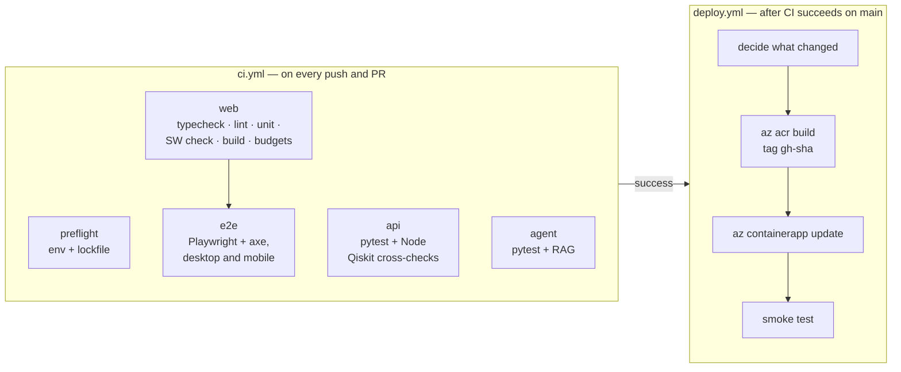

# CI pipeline

Every push and pull request runs five jobs in GitHub Actions. All of them must pass; a green run on `main` is what the deployment workflow waits for.

## Jobs

**preflight.** Node 20, built-ins only: Node version, lockfile present and in sync, workspace linkage, configuration files parse. It is the cheapest signal and runs first.

**web.** Restore `node_modules` from a cache keyed on the lockfile (or `npm ci`), then in order: `tsc --noEmit` against the strict configuration, ESLint, the Vitest suite, the service-worker invalidation check, `next build`, and the bundle-budget check. The bundle report is uploaded as an artefact on every run so a size trend can be read back without re-running anything.

**e2e.** Depends on `web`. Installs Chromium with system dependencies, builds the production app and runs both Playwright projects, including the axe and structural accessibility specs. On failure the HTML report and traces are uploaded with a seven-day retention.

**api.** Python 3.11 with a pip cache, plus **Node 20 and the repository's `node_modules`**, because the JS-versus-Qiskit cross-checks transpile and execute the real browser engine. `python -m app.core.env_check` must pass with an empty environment, then the 357-test suite runs. `test_js_bridge_available.py` fails the job rather than skipping if the Node bridge is missing, so a cross-check can never be silently absent from a green run.

**agent.** Python 3.11, installs the development requirements (which add scikit-learn for the index-building tests), runs the environment validator and the 109-test suite.

Concurrency is grouped per branch with in-progress cancellation, so a rapid series of pushes tests only the latest.

## Continuous deployment

`deploy.yml` runs on `workflow_run` when CI completes successfully on `main`, or by hand with an optional list of services. It is **off by default** and does nothing until the repository variable `AZURE_DEPLOY_ENABLED` is `true` and the OIDC secrets exist, so forking the repository cannot deploy anywhere.

1. **Decide what to deploy** by diffing the commit: changes under `apps/web/`, `packages/` or the lockfile mean web; `services/api/` means api; `services/agent/` means agent. Unchanged services are not rebuilt.
2. **Refuse a web build with sign-in switched off.** If the Supabase repository variables are empty the job fails, because a web image built without them ships with accounts silently disabled. This check exists because it happened once.
3. **Authenticate to Azure with OIDC.** The federated credential is scoped to this repository's `production` environment and the one resource group; no client secret is stored.
4. **Build in Azure Container Registry** with `az acr build`, tagged `gh-<12-char sha>`, passing the public build arguments, then point each changed Container App at the new image with `az containerapp update`.
5. **Smoke test.** Wait, then `curl` the public health endpoint with retries, and for a web deploy fetch `/account` and fail if it shows the no-accounts fallback.

The workflow never touches secrets or environment variables; those belong to `infra/azure/deploy.sh`, which is the tool for first deploys, rotation and new variables. Deployment concurrency is a single group with cancellation disabled, so a half-finished rollout is never abandoned.

## iOS and documentation workflows

`ios.yml` runs on changes to `apps/ios/`: it installs XcodeGen on a macOS runner, generates the project from `project.yml` and performs an unsigned simulator build, so a Swift change that does not compile is caught without an Apple account. `pages.yml` builds this documentation site with `mkdocs build --strict` (a broken link fails the build) and uploads it to Cloudflare Pages at docs.qubit16.ai.

## What is not in CI, and why it is written down

The repository is explicit about gaps rather than quiet about them. There is no WebKit or Firefox end-to-end project (Chromium only, including the mobile emulation), no screen-reader run, and no CodeQL or secret-scanning job in the workflow file; dependency auditing is run on a schedule outside the pipeline. The accessibility audit lists the routes it has not covered. These are tracked as work, not hidden.
