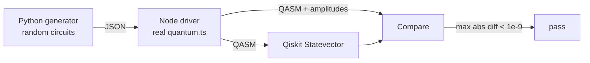

# Verification against Qiskit

The browser simulator is a hand-written statevector engine. Its correctness is not assumed; it is established by executing the real TypeScript module against independent reference implementations and comparing every amplitude.

## Three layers of checks

| Layer | Where | What it proves |
| --- | --- | --- |
| **Unit tests** | `apps/web/lib/quantum*.test.ts`, `apps/web/lib/quantum/*.test.ts` | Analytic values (Bell, GHZ, Grover, teleportation), adversarial inputs, classical-control branch probabilities, QASM parsing edge cases |
| **Pinned fixture** | `apps/web/lib/quantum.crosscheck.test.ts` → `services/api/tests/data/js_statevectors.json` → `test_js_crosscheck.py` | A fixed set of 13 circuits whose exported QASM and amplitudes are frozen; the Python side runs the same QASM through Qiskit |
| **Random cross-check** | `services/api/tests/test_js_random_crosscheck.py`, `test_js_extended_crosscheck.py` | Hundreds of freshly generated circuits, executed through the real `quantum.ts` in Node, compared against Qiskit (and PennyLane where installed) |

The random layer is the one that catches bugs that only appear in combination. The fixture layer catches a changed convention. The unit layer catches a wrong formula.

## How the real module is executed from Python

The Python test suite does not reimplement anything. It transpiles `apps/web/lib/quantum.ts` with esbuild (`--bundle`, so the engine's own imports resolve), runs it in Node through a small driver (`services/api/tests/jsbridge/driver.mjs`) that accepts circuits on stdin and returns QASM, amplitudes, labels and seeded counts on stdout, then parses the exported QASM with the service's own `parse_qasm` and simulates it with Qiskit's `Statevector`.

Because the bundle is rebuilt on every run, a stale artefact cannot make the suite pass against a version of the engine that no longer ships.

## Coverage

The extended suite (`test_js_extended_crosscheck.py`) generates six circuits at each of 2, 3, 5, 8, 12 and **16 qubits**, each ten gates deep per qubit, drawing from the whole palette:

- single-qubit gates H, X, Y, Z, S, S†, T, T†, √X, √X†, RX, RY, RZ, P and U3(θ, φ, λ)
- custom 2×2 and 4×4 unitaries
- single-qubit gates behind one to three controls in **X, Y or Z basis**, some negated
- CX, CY, CZ, SWAP, CCX (Toffoli), CSWAP (Fredkin), multi-controlled X
- QFT and inverse QFT, plain and controlled
- modular add and modular multiply blocks, plain and controlled

Every amplitude of the exported QASM must match Qiskit to **10⁻⁹, global phase included**. The measured worst case across the suite is of order 10⁻¹⁴, so the tolerance has five orders of magnitude of headroom while still failing on any sign, operand-order or phase-convention error (the smallest such error moves an amplitude by order 10⁻³).

Circuits with mid-circuit measurement and classical feed-forward have no single statevector to compare. They are verified separately: the exact branch enumeration (`outcomeBranches`) and the final probability distribution were checked against an independent branch-by-branch NumPy simulation on 63 dynamic circuits of up to 16 qubits and 256 branches, agreeing to 10⁻¹⁴.

## What the cross-check found

This machinery earns its keep. In October 2026 the extended suite revealed that a custom single-qubit matrix placed behind a control was exported to OpenQASM as a bare `U(θ, φ, λ)`, dropping the matrix's global phase. Uncontrolled, a global phase is unobservable; behind a control it becomes a *relative* phase, so the exported file computed a different state from the one the simulator displayed, with fidelity against Qiskit as low as 0.02. The simulator itself was always right; the export was not. The exporter now reuses the named `qb16_uN` gate whose body carries `gphase(γ)`, the importer reads it back, and 29 of 36 circuits that failed before the fix pass after it.

## Why it runs in CI, not just locally

The API service's CI job installs Node and the repository's `node_modules` so these suites can execute. A dedicated test, `test_js_bridge_available.py`, **fails** the job (rather than skipping) if Node or esbuild is missing when the `CI` environment variable is set. A skipped cross-check is indistinguishable from a passing one in a green CI run, and that is precisely the failure mode this guard exists to prevent.

## Numerical conventions

- **Qubit 0 is the least significant bit** of a basis index; labels print most-significant qubit first. This matches Qiskit's display convention and is recorded in `docs/adr/0003-qubit-0-is-the-lsb-with-msb-first-labels.md`.
- The fixture comparison allows 10⁻¹² on amplitudes rather than bit equality: `Math.sin`/`Math.cos` are not required to be correctly rounded and a JavaScript engine upgrade has moved their last bit. Everything else in the fixture (QASM text, labels, qubit count) must match exactly.
- Number formatting that feeds test assertions is pinned (`apps/web/lib/numerics`), so a hydration or fixture mismatch cannot arise from locale or rounding differences between Node and the browser.
